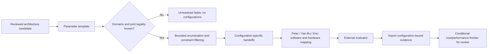

# Bounded parameter exploration

DX100 owner handoff: [defaults, candidate values, topology/resource constraints and API/kernel changes](../dx100-parameter-domain/README.md), with a [machine-readable source contract](../dx100-parameter-domain/contract.yaml). The handoff preserves unresolved legal domains and distinguishes source-supported candidates from target-validated settings.


The offline framework now enumerates configuration proposals from **explicit,
reviewed finite domains**, filters declared coupled constraints, and emits
configuration-specific software handoffs. Unknown ranges and costs remain unknown.
It does not execute kernels, rewrite code, run simulators, invoke a model, infer
area scaling, or automatically select/deploy a configuration.



## What stays unresolved

The catalog's `fixed_reference` value is neither an approved runtime setting nor
a legal search range. DX100's reference tile size of 16,384 is preserved as source
context; the framework does not infer powers of two, smaller alternatives, or a
maximum effective capacity. MAPLE's configurable queue allocation and prefetch
distance still have null domains. Reference configurations from different source
versions are never merged.

Every new forward-pipeline candidate package includes
`parameter-space.template.yaml`. Initially each parameter has:

- Its unmodified catalog ID, unit, state, reference value/domain, claims and notes.
- `role: unresolved`, `legal_domain: null`, `review: null`.
- `software_impact: null`.

The whole template also has `coupled_constraints: null`, `legality_review: null`,
`cost_model: null`, and null area/power limits. The default **search budgets** of
64 emitted configurations and 4,096 checked combinations are software execution
limits, not hardware bounds or recommendations.

## Supplying a bounded space

For each parameter, its owner explicitly chooses:

- `enumerate`: provide a finite numeric `enum` or inclusive `integer_range` with
  integer `min`, `max` and positive `step`. A singleton enum explicitly fixes one
  reviewed value for the sweep.
- `reference_only`: retain contextual information without assigning it as a knob.
  This exclusion also requires review. Reference fields cannot silently become
  effective settings or disappear.
- `unresolved`: keep the sweep blocked pending clarification.

A review records `reviewer`, `rationale`, and `evidence_refs`. References resolve
against the candidate's source claims or a supplied evidence registry. These
records are supplied by the owner; the tool does not authenticate reviewers or
prove that a cited paper establishes the declared domain.

Joint legality needs an explicit review and a constraint list. **Null means
unknown; an empty reviewed list declares that no additional coupling is required
for this particular space.** Supported finite predicates are:

| Kind | Fields beyond `id`, `kind`, `parameters` | Meaning |
|---|---|---|
| `equal` | none | First of two knobs equals the second |
| `less_equal` | none | First of two knobs is at most the second |
| `power_of_two` | none | One positive integer knob is a power of two |
| `product_at_most` | `limit` | Product of named knobs is at most an explicit limit |
| `allowed_tuples` | `values` | Only listed joint tuples are permitted |

No expression string, Python code or shell command is evaluated. The owner must
establish consistent units; the tool does not infer conversions. Numeric product
checks use exact rational arithmetic over decimal textual values. A partially
unknown coupling must remain unresolved, not be dropped to make the sweep run.
This is an ordinary YAML interchange format for a finite sweep, not a proposed
project-wide DSL or replacement for LANL's eventual interface.

Optional `software_impact` records use `requires_adaptation` or
`no_change_reviewed`, with description and evidence. Null stays pending. The
framework does not assume changing tile capacity is purely a hardware edit.

## Enumeration and handoff

The explorer sorts knob IDs and numeric values for deterministic traversal. It
checks combinations lazily and stops at either declared budget. It reports total,
checked and unvisited combinations, rejected combinations and failed constraints.
A truncated prefix is **not** an exhaustive search. No configuration in a prefix
is not a claim that the full declared space has no solution.

Each configuration identity binds the base candidate, full parameter-space
snapshot, workload/catalog input hashes, selected values, and synthetic/real mode.
Changing the parameter contract, bounds, budget or bindings creates new identities.
The original candidate's `selected_configuration` and catalog are never edited.
A configured proposal is a separate record, not a claim of an executable design.

Each configuration directory contains:

- `configuration.yaml`: selected values, identity, pending status and null metrics.
- `software-handoff.yaml`: per-knob impacts and required implementation follow-up.
- `evaluation-binding.template.yaml`: configuration hash plus null software,
  hardware-mapping/build hashes and evaluation record for the external team to fill.

The complete original candidate is retained at the bundle root, preserving its
planned block, intrinsic operation contracts and source requirements. References
inside generated records are interpreted relative to that bundle root. The
framework does not regenerate an ABI or apply source changes: Peter/Yan-Ru and
Eric must bind the actual software and hardware artifacts for each configuration.

## Evaluation and unknown costs

Enumeration never computes latency, area or power—even if a cost-model reference
has been supplied. All initial metrics remain null. The optional `cost_model`
record identifies an expected external model by SHA-256, description and evidence;
comparison rejects a different supplied model.

`compare` imports one aggregated external evaluation per configuration, with:

1. Matching space/input/catalog bindings and synthetic mode.
2. An `implementation` mapping containing `configuration_sha256`,
   `software_sha256`, `hardware_sha256` and `build_sha256`.
3. An `evaluation` record using the existing evolution-policy fields. Its
   `candidate_id` is the configuration ID. Both candidate-content hashes must
   equal `evolution_store.digest(implementation)`, binding the evaluated software,
   hardware mapping and build rather than only the parameter proposal.
4. A fixed comparison cohort: workload bundle, baseline, ROI, environment,
   evaluator, cost model, assumptions, aggregation, units and evidence tier.

The comparator regenerates the bounded configurations from the supplied candidate
and space. Unknown, stale or non-enumerated configuration IDs cannot enter the
frontier. Placeholder values, missing costs, incomplete or refuted runs, missing
execution witnesses and mismatched cohorts are rejected using the existing
policy checks. A completed record still requires independent evidence; hashes
and nonempty references do not authenticate a measurement or prove correctness.

An explicitly supplied area limit filters excessive area. A supplied power limit
also requires a reported power value. Null limits remain listed as unresolved;
there is no inferred hardware budget and **no automatic winner**. The output is
only a point latency/area frontier for review. A credible evaluator can supply
cost evidence even when the original forecast model was unknown; the frozen
comparison cohort names its model, and the original null forecast remains null.

## Run it

Generate ordinary candidate packages as before; each now has an unfilled template.
For an existing package, make a separate template if needed:

```sh
.venv/bin/python -m archevolve.parameter_cli template \
  --candidate path/to/candidate.yaml \
  --input-sha256 INPUT_HASH --catalog-sha256 CATALOG_HASH \
  --output .cache/parameter-space.yaml
```

After the owners provide and review the missing fields, enumerate into a fresh
output directory:

```sh
.venv/bin/python -m archevolve.parameter_cli enumerate \
  --candidate path/to/candidate.yaml --space path/to/reviewed-space.yaml \
  --output-dir .cache/parameter-sweep
```

Use the clearly [synthetic fixture](../../../examples/parameters/space.yaml) to
exercise the framework immediately:

```sh
.venv/bin/python -m archevolve.parameter_cli enumerate \
  --candidate examples/parameters/candidate.yaml \
  --space examples/parameters/space.yaml --output-dir .cache/parameter-demo
```

It declares three lane counts and three depths. Nine combinations are checked;
five satisfy the supplied power-of-two and shared-capacity rules. These numbers
are invented test inputs, **not DX100/MAPLE legal settings**. Costs and software
impacts remain null. The [summary](../../../examples/parameters/summary.yaml)
records this behavior and the blocked real-DX100 template check.

When independent evaluator records are available, fill `evaluations.template.yaml`
using the per-configuration binding templates, then run:

```sh
.venv/bin/python -m archevolve.parameter_cli compare \
  --candidate path/to/candidate.yaml --space path/to/reviewed-space.yaml \
  --evaluations path/to/evaluations.yaml --cohort path/to/cohort.yaml \
  --output-dir .cache/parameter-comparison
.venv/bin/python -m unittest discover -s tests -p 'test_parameter_exploration.py' -v
```

Outputs are never overwritten. This is a bounded offline sweep and evidence intake;
automatic job submission, simulator calibration, actual kernel rewrites and a
campaign scheduler remain external. It can feed the evaluator/learning pipeline
later without converting reference sizes or unavailable costs into invented facts.
