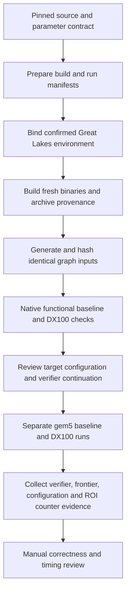

# Standalone DX100 reference validation — local preparation

This workflow prepares the **16,384-element, four-core, one-instance** reference
for the authors' standalone `TDStepMAA`, alongside the pinned `TDStep` CPU control.
It is not our proposed CPU-CAS read-offload implementation or MAPLE hybrid.

**No builds, native benchmarks, gem5 runs, Great Lakes login or scheduler
submissions have occurred.** The checked-in [preflight](../../../examples/dx100-reference-validation/preflight.yaml)
is blocked on the intentionally unbound environment. Correctness, target timing,
parameter admission and speedup remain unestablished.



## Prepared artifacts

The [example bundle](../../../examples/dx100-reference-validation) contains:

- `workflow.yaml`: pinned source hashes, declared versus effective settings,
  compile constants, validation cases and evidence requirements.
- `environment.template.yaml`: null server/toolchain/resource/platform bindings.
- `build-recipes.yaml`: argv templates for Ramulator2, m5ops, gem5, converter,
  fresh m5op object and four separate BFS binaries.
- `run-plan.yaml`: staged execution requirements; the actual gem5 command remains
  null until the complete platform/launcher is reviewed.
- `guest.env`: explicit four-worker OpenMP settings for the guest.
- Run/build/graph/exit-event receipt templates and an unbound preflight result.

The preparation tool reads pinned Git objects and checks Eric's source hashes.
It adds the relevant API/GAP headers and launcher/build files to the build-source
manifest. At execution-site preflight, those hashes are checked against actual
files, with the checkout at the pinned revision and no tracked modifications.
Installed compiler/runtime dependencies still require their own build provenance.

## Important findings in the pinned source

**Effective configuration differs from SimObject defaults.** The declarations
specify 512 outstanding packets on each side, but `configs/common/MAAConfig.py`
sets both values to `max(512, 2 × num_maas × num_tile_elements)`: **32,768** here.
The workflow preserves both sets and checks effective `config.ini` against the
launcher-derived values. It does not edit Eric's original contract. Its receipt
identity binds this effective tuple; do not attach it unchanged to an earlier
provisional tuple that still specified 512.

**A simulator exit is not a verifier pass.** In `bfs.cc`, both GEM5 kernels call
`m5_exit` before returning to `BenchmarkKernel`, where `BFSVerifier` is invoked.
The pinned `Simulation.py::benchCheckpoints` continues checkpoint events but
returns on the non-checkpoint exit. Therefore a stock run may end at the ROI
without ever printing verification. `exit_code: 0` and `ROI End!!!` are insufficient.
A separately reviewed launcher continuation or target verification method must
finish verification while preserving the ROI stats separately. This preparation
does not patch the simulator/source or assume that method already exists.

**The stock CPU control initializes MAA too.** `DOBFS` calls `alloc_MAA/init_MAA`
before the ROI. Keep the same MAA memory mapping present for the target control;
expect zero indirect-read/range instructions inside its ROI. Disabling MAA while
using that binary is not a supported shortcut. A baseline with no accelerator
mapping would require a separately reviewed source/binary variant.

**Host environment is not guest evidence.** The pinned `se.py` sets `process.env`
from `--env`. Bind the supplied `guest.env` explicitly in the reviewed system argv.
The printed `ROI started: 1 threads` is outside an OpenMP parallel region and must
not be used as the worker-count measurement. The simulated four cores/workers are
also distinct from the host Slurm CPU allocation.

**Do not infer DRAM geometry from the filename or preset alone.** Bind the actual
organization reported to MAA, including channel/rank/bankgroup/bank dimensions and
runtime controller arrangement. The preflight checks the necessary slice family
and divisibility/coverage for the reference initial slice count 32; it does not
prove DRAM timing, topology binding or the complete address mapping.

## Once Great Lakes is confirmed

1. Bind source/work/build/run paths, Linux x86-64 toolchain, dependency versions,
   build parallelism, account/partition and actual CPU/memory/time allocation.
   Nothing is guessed from the four simulated cores.
2. Review the complete CPU/cache/clock/memory/Ramulator configuration, actual
   memory organization, memory-map sizes, checkpoint policy and verifier
   continuation method. The stock four-core API expects **16 GiB** of simulated
   memory (`MEM_SIZE=0x400000000`), not a host-memory allocation recommendation.
3. Build into fresh output names. Do not use repository-shipped binaries or
   `benchmarks/gapbs/m5op.o`. The recipes compile a fresh object and distinguish
   `-DFUNC` versus `-DGEM5`, with `-DMAA` only on the accelerated variant.
4. Capture actual argv/cwd, allowlisted build environment, compiler/dependency
   versions, stdout/stderr, exit status and binary/object/library hashes. Capture
   an effective macro dump using the same preprocessor flags (`-dM -E` with the
   same source/include/define inputs). Do not treat a planned command as a build receipt.
5. Generate **Kronecker18 and uniform18, degree 16**, once each with the pinned
   converter/seed. Archive each `.sg` hash and use the identical bytes for both
   variants. These are initial validation cases, not a reproduction of the paper's
   larger benchmark configurations. Root is 0; trials are 1; `-v -l -a` is required.
6. Run the functional baseline and functional DX100 binaries separately. This
   establishes only native functional-model observations; their runtimes are not
   accelerator timings. GEM5/MMIO binaries must run inside gem5, not natively.
7. After the target platform/exit handling is reviewed, run the target baseline
   and target DX100 separately, retaining `config.ini`, raw stdout/stderr, complete
   `stats.txt`, exact launcher/simulator/Ramulator hashes and the exit-event chain.

The build/run manifests are **unexecuted templates**, not a complete launch command
or automatic Slurm script. The target argv deliberately stays null rather than
inventing cache settings, resource allocations or an exit handler. No command in
this tool submits jobs or executes a recipe.

## Checks and their limits

The collector checks:

- Workflow/environment identity and supplied artifact hashes.
- Build-source/binary/macro provenance; matching 16K/four-core compile constants
  and `FUNC`/`GEM5`/`MAA` mode selection.
- Exact graph/root/trial/verify arguments and recorded generation identity.
- One `Verification: PASS`; any observed `FAIL` overrides a zero exit code.
- Per-level `Starting TDStep` / `Starting TDStepMAA` frontier sizes. Parent arrays
  need not match byte-for-byte between correct parallel runs.
- The 26 effective MAA scalar settings in an unambiguous `config.ini` section.
- Exactly identified ROI markers and a caller-selected complete stats block.
- Positive `system.maa.numInst_INDRD` and `system.maa.numInst_RANGE` for DX100;
  zero for the CPU control. A function-entry log alone does not prove offload:
  `TDStepMAA` can take its CPU fallback.

Missing evidence and incomplete runs stay inconclusive. Completed runs that fail
the verifier or required activity check are refuted. Bad hashes/bindings reject
the receipt rather than diagnosing the architecture itself. Equal frontier counts
do not override failed or incomplete checks.

Neither a positive counter nor a verifier PASS independently establishes the
other. All CPU/cache/MMIO/Ramulator settings, the precise stats-to-ROI association,
actual execution provenance and target timing still require review. The tool does
not authenticate receipt authors or certify that a simulator's cycle counts are
realistic. It never divides ticks by a hardcoded 313, converts functional wall time
into hardware time, reports speedup, or promotes a parameter tuple automatically.

## Commands

Prepare from the existing pinned DX100 checkout:

```sh
.venv/bin/python -m archevolve.dx100_validation_cli prepare \
  --source-root sources/DX100 --output-dir .cache/dx100-reference-prepared
```

A local Git checkout containing the pinned objects is required for preparation.
The ordinary parser/collector unit tests use the checked-in preparation fixture;
the source-audit integration test skips when that external checkout is absent.

Copy and fill `environment.template.yaml` once the site is confirmed, then:

```sh
.venv/bin/python -m archevolve.dx100_validation_cli preflight \
  --workflow .cache/dx100-reference-prepared/workflow.yaml \
  --environment path/to/bound-environment.yaml --output-dir .cache/dx100-preflight
```

Reviews use `{reviewer, description, evidence_refs}`. The checker's best status is
`inputs_present_pending_manual_review`; it never launches the target. The target
`system_argv` must explicitly contain `--env` pointing to the bound guest file.

After actual execution, fill one run receipt per mode/variant/workload. Artifacts
use `{path, sha256}`; relative paths resolve against the receipt directory. Build
and graph receipt templates describe their JSON fields. `generator_options` records
actual options such as `[-g, 18, -k, 16, -b, /path/to/graph.sg]` as strings. Capture
exit events with causes/ticks/actions and whether the guest truly completed. Choose
`stats_block_index` explicitly (zero-based); do not assume the last dump is the ROI.

```sh
.venv/bin/python -m archevolve.dx100_validation_cli collect \
  --workflow .cache/dx100-reference-prepared/workflow.yaml \
  --environment path/to/bound-environment.yaml --receipt path/to/run-receipt.yaml \
  --output-dir .cache/dx100-collected

.venv/bin/python -m archevolve.dx100_validation_cli compare \
  --baseline path/to/baseline/result.yaml --accelerated path/to/dx100/result.yaml \
  --output-dir .cache/dx100-frontier-comparison
```

Collection archives raw text-sized logs/configuration/receipt evidence byte-for-byte
(up to 64 MiB per text artifact). Binaries, graphs and simulator/libraries stay as
explicit content-hashed references; retain their original files. Oversized text
files are marked as exceeding the reader budget, not silently interpreted. Output
directories must be fresh. Inconclusive/refuted collection results are written
successfully as reports: command exit code zero does not mean validation passed.

```sh
.venv/bin/python -m unittest discover -s tests -p 'test_dx100_validation.py' -v
```

The current deliverable is preparation plus tested evidence handling. The next
external step is confirming the Great Lakes environment and reviewing the target
launcher/verification continuation, then executing and retaining real receipts.
