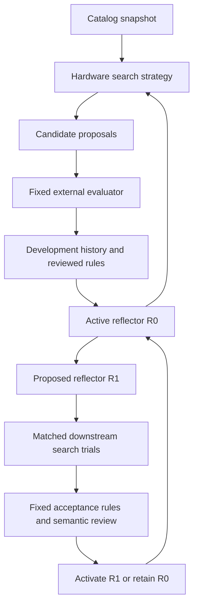

# Offline evolution runtime and reflector revision

**October 16 integration:** [source-bound saved proposals](../planning-loop-integration/README.md) now exercise real hardware planning and handoff generation through `offline_planning` mode. Structural feedback enters this store without a fabricated timing/cohort; performance trials and promotion remain disabled in that mode. The synthetic demo below is retained as a separate state-machine test.

Implemented October 11, 2026. This is a runnable **offline coordinator**, not an
LLM integration or a demonstrated self-improving hardware system. The included
proposer, evaluator and reviewer are explicitly scripted synthetic fixtures.
Nothing here measures BFS, MAPLE or DX100 performance or changes their catalog.

## Fundamental operation

1. Snapshot the hardware catalog, fixed core, tasks, evaluation cohorts and budget
   policy. Install a seed search strategy and seed reflector.
2. Run development search. A proposer receives the strategy, reflector identity for provenance, prior
   development evidence, reviewed rules and an explicit parent design. An
   independently supplied evaluator returns content-bound results. Eligible
   improvements can become the next proposal's parent within that task's epoch.
3. Preserve all attempts and outcomes. Failed/ineligible designs cannot become
   successful parents. On a later epoch, the immutable baseline starts the task
   again; the accumulated development history remains available as context.
4. Propose a learned rule or revised search strategy. Rules require conditions,
   transformation, obligations, support, counterexamples and limitations. A
   recorded semantic review admits them as search guidance, not hardware facts.
5. For a strategy trial, compare parent and child strategies. For a **reflector
   trial**, let each reflector derive a strategy from the same frozen history and
   seed strategy, then run both resulting strategies on the same validation tasks.
6. A qualifying trial plus an explicit review can activate the child. Once R1 is
   active, ordinary strategy updates and the next reflector proposal use R1's
   content and record R1 as their author. R1 can thus propose R2. A no-gain R2 stays
   archived without replacing R1. Rollback restores the previous activation.

The editable reflector has four text sections: evidence selection, diagnosis,
generalization and revision method. The fixed request envelope and external
acceptance algorithm do not evolve. This is a bounded experiment in recursive
**prompt/procedure** revision, not unrestricted source-code or model-weight
self-modification. Its efficacy and novelty remain unproven.



## What is stored, and where

`EvolutionStore` uses one local SQLite database per campaign, requiring no new
Python dependency. Canonical JSON objects have SHA-256 identities; append-only
application events reference them. Transactions preserve each event/object pair.
Export produces portable JSON (also valid YAML 1.2), including all referenced
objects. Stored hashes detect changed payloads; they do not authenticate authors
or establish that scientific claims are true.

| Record | Purpose |
|---|---|
| Catalog/core/policy snapshot | Frozen facts, scope, task split and evaluation conventions |
| Call/evaluation starts and outcomes | Requests, receipts, failures and budget consumption |
| Observation | Candidate, explicit parent, task, strategy, reflector, evidence and exclusions |
| Strategy/reflector revision | Parent version, author reflector, motivating evidence and fixed pins |
| Rule proposal/admission | Conditional experimental lesson and review, separate from catalog claims |
| Trial | Frozen shared context, both arms, costs, scores and review eligibility |
| Activation/rollback | Durable active-version history without deleting prior evidence |

Eric's `catalog/hardware-v0.1.yaml` remains the source-backed hardware catalog.
Experimental rules link to its snapshot. There is intentionally no function that
silently inserts a learned rule into that catalog. New hardware facts/designs
still require the team's catalog admission process.

## Comparison and evidence boundaries

The first implemented objective is **best eligible latency under a fixed area
limit**, separately for each validation task. An unchanged baseline is the
fallback. It is not a Pareto-hypervolume or statistical-significance estimator;
the existing reference Pareto function remains available separately.

Both arms receive equal proposal/evaluation allowances and worst-case token
allowances. Reflector trials include one strategy-reflection call per arm.
Promotion eligibility requires all child observations eligible, no task latency
regression, and mean relative improvement above the predeclared threshold. A
recorded semantic review is then mandatory. This conservative point comparison
is prototype policy; repeat independent campaigns and quantify uncertainty before
making research claims. Thresholds are frozen campaign choices, not discovered
hardware parameters.

All candidate generation, rule extraction, reflector revision and trial calls
consume the global campaign budget, including failures. A call that never returns
a valid receipt reserves its maximum token allocation. Both trial arms are
preflighted before either starts. Token counts are trusted adapter receipts;
this implementation does not enforce live-model tokens, process timeouts or
sandbox arbitrary adapters. The cost of generating the proposed revision is
recorded globally, outside the two arms; a full fixed-vs-adaptive research
comparison must include that cost in the adaptive campaign's total budget.

Evaluator results pass the existing cohort/content/correctness/witness/area
checks. Referenced evidence objects must exist in memory. Placeholder,
wrong-cohort, refuted, missing-witness or incomplete results cannot improve a
score. This validates record consistency, **not the truth of an evaluator's
claims**. Adapters and review submissions are trusted application code; an LLM
must not be allowed to submit its own acceptance review or replace the evaluator.
Synthetic mode cannot be mixed with non-synthetic results or reviews.

Only development observations enter reflection context. Validation results are
used by the fixed acceptance procedure; final holdout tasks are neither executed
nor sent to the proposer. Task descriptions/inputs must themselves be curated to
avoid answer leakage. Repeated validation still creates selection bias; keep
final reporting holdouts outside adaptation.

## Run the offline demonstration

From the repository root, use a **fresh** store path:

```sh
.venv/bin/python -m archevolve.evolution_demo demo \
  --store .cache/evolution-demo/memory.sqlite \
  --output .cache/evolution-demo/report.json

.venv/bin/python -m archevolve.evolution_demo export \
  --store .cache/evolution-demo/memory.sqlite \
  --output .cache/evolution-demo/memory.json

.venv/bin/python -m unittest discover -s tests -p 'test_evolution*.py' -v
```

The demo uses invented metadata/bulk-fetcher tasks and timings. Its scripted
proposer first chooses overlap everywhere. A revised reflector causes the
scripted proposer to account for handoff cost and choose serial execution for
small batches. It exercises rule admission, a rejected strategy trial, an
accepted reflector, a downstream strategy promotion, an R1-authored R2 proposal
with no extra gain, and rollback. The numerical outcomes were deliberately chosen
to exercise these transitions. **The script does not discover the rule or learn
anything.** The compact checked-in example summary contains references and counts;
the command regenerates the full trace. See [demo summary](../../../examples/evolution/demo-summary.json).

## Connecting actual project evidence later

Use `OfflineEvolution.initialize(store, catalog=..., core=..., policy=...,
strategy=..., reflector=...)` once, then construct
`OfflineEvolution(store, proposer, evaluator)`. Reopening the database restores
active versions and usage; interrupted trials remain incomplete and cannot be
promoted. Retry them as new attempts, consuming new budget. A single coordinator
must own a store; multi-process orchestration is not supported.

- `proposer(request)` returns `{content, tokens}` for `propose`, `revise_strategy`,
  `revise_reflector`, or `learn_rule`. The reference seed inputs/demo show exact
  envelopes. Real prompt adapters should assemble the fixed core with the current
  versioned sections, not ignore them as the scripted fixture does.
- `evaluator(request)` returns the existing evolution-policy record plus explicit
  `synthetic: false` in `offline_evidence` mode. It must bind the exact candidate
  hash, scoped cohort and independently sourced evidence. Preserve evidence
  payloads through `store.put(...)` before returning their references. The cohort
  uses the canonical catalog object's hash, not the YAML file's byte hash.
- `run_epoch()` collects development proposals/evidence; `revise(kind)` returns a
  pending revision; `trial(ref)` compares it; `promote(trial_ref, review)` activates
  it only after the gates; `rollback(kind, review)` restores prior activation.
- `propose_rule()` and `admit_rule(ref, review)` maintain learned guidance.

Still needed for real ArchEvolve experiments: model/recorded-proposal adapters,
actual hardware candidate lowering through Peter/Yan-Ru, credible target or
calibrated analytical evaluator inputs, explicit orchestration/retry policy and
repeated experimental campaigns. Live execution remains unconnected; no API calls
or teammate messages are sent by this change.

## Verification

The evolution-specific tests run with the project's existing PyYAML environment;
the runtime itself uses only the Python standard library. The repository's newer
profiling-helper tests also require NumPy, which was absent from this checkout's
`.venv`. For the full suite, verification used the installed bundled Python with
NumPy plus the checkout's PyYAML on `PYTHONPATH`; no dependencies were added by
this change. This dependency limitation belongs to the full test environment,
not the new offline runtime.
