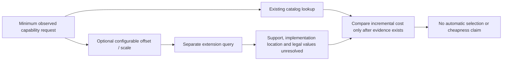

# Optional generalizations for review

Optional source-annotation hypotheses; cheapness, hardware support, legal domains and new workload coverage remain unestablished.

Emitted 1 proposals from 1 supported literal sites. Truncated: False.

| Source request | Observed annotation | Proposed annotation | Baseline setting |
|---|---|---|---|
| access-02-read | VertexOffsets[u] and VertexOffsets[u + 1] | VertexOffsets[u] and VertexOffsets[u + ae_offset] | 1 |

Annotations are not rewritten C++ or a hardware implementation. The observed setting restores the annotation AST, not a proof of program/hardware equivalence.
The parameter may be supplied by existing host/interface mechanisms; no new adder, multiplier, register or cost is assumed.
All hardware-support answers, additional requirements, legal domains and cost deltas remain null. Minimum catalog matches do not certify extensions.

[Proposals](generalization-proposals.yaml) · [Paired database requests](generalization-queries.yaml)
