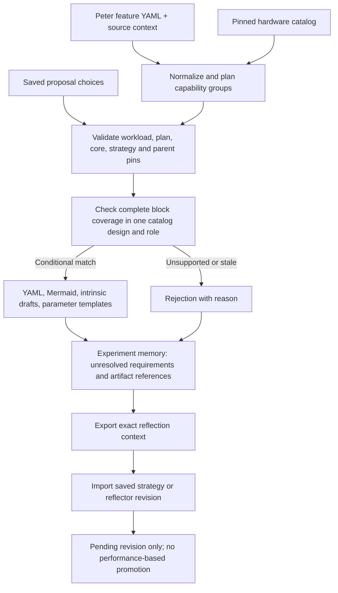

# Saved proposals through the hardware planning loop

The evolutionary coordinator now connects to the **real offline workload →
capability planning → catalog lookup → handoff pipeline**, using saved proposal
records. It preserves structural results in the same experiment store used by
strategy/reflector revision. There is no model call, synthetic timing, software
rewrite, hardware simulation or performance ranking in this path.



## What a saved proposal can change

A proposal selects **one existing catalog design and execute/assist role for each
planned block**, or explicitly retains the block on the CPU. Every planned block
must appear exactly once. The grouped requirements themselves are immutable.
The accepted mutation labels are `placement` and `simplification` for this path.

The bridge rejects dropped/duplicate blocks, unsupported roles/designs, partial
coverage and added capabilities or configuration fields. It cannot silently
combine multiple accelerators into one solution, invent an intrinsic, alter the
workload, or bypass the bounded-parameter framework. Missing catalog type evidence
remains a conditional mapping gap; matching does not establish shared-resource,
mutable-load, concurrency or completion correctness.

Each saved response binds its task, fixed core, strategy, development-history
snapshot and parent. Its design also pins the input file, catalog file, source
context, derived hardware plan and pipeline implementation. Replay never repairs
or updates those bindings. Changes require a newly authored proposal against the
new context. Catalog/input/source pins are file SHA-256; plan, core, strategy,
parent and memory identities use canonical JSON digests. They are different hash
conventions and should not be interchanged.

## The included BFS replay

[Saved proposals](../../../examples/planning-replay/bfs.proposals.yaml) are explicitly
hand-authored fixtures using the real BFS reports and catalog—not model outputs:

1. **DX100 indexed reads:** generates the actual candidate/diagram/intrinsic
   package; mapping obligations and unknown parameter domains remain unresolved.
2. **MAPLE indexed reads:** generates a conditional package, retaining missing
   type/width evidence, mapping obligations and unknown parameter domains.
3. **DX100 CAS:** intentionally requests an unsupported operation. The bridge
   rejects it and records the reason; no package is generated.

Streaming reads and other blocks are explicitly retained on the CPU in these
examples. The generated source is unchanged. See the [compact replay summary](../../../examples/planning-replay/summary.yaml).
Full packages are generated locally; the repository does not duplicate the large
catalog snapshots and experiment-memory payloads for each replay.

## Structural mode, not invented evaluation

Previously, `OfflineEvolution.initialize` required timing, a cost limit and a
comparison cohort. The new `offline_planning` mode instead requires those fields
to be **null**. It accepts `planning_feedback` from the bridge and stores actual
compatibility checks, requirement IDs, missing evidence and bundle references.

Every observation is ineligible for performance ranking. Cost/time fields stay
null. Structural success cannot replace the best-performing parent, admit a
performance-backed rule, run a quantitative trial, or promote a strategy/reflector.
Existing `offline_evidence` and synthetic demonstration modes retain their
stricter quantitative prerequisites. Moving to measured search requires a separate
campaign with a real baseline/cohort and independent evaluator evidence; it is
not a flag that upgrades historical structural observations.

The store's generic `calls` counter counts replay requests and `evaluations`
counts callback checks. Here both are **offline operations**, not LLM calls or
hardware runs. Saved responses use `tokens: 0`; the exported report separately
states `llm_calls: 0` and `hardware_evaluations: 0`.

## Handoff and feedback artifacts

Each structurally accepted proposal produces:

- Original feature, catalog and source-context snapshots; normalized features.
- `hardware-plan.yaml`, complete block coverage results and selection trace.
- A hardware request with explicit saved block choices and CPU retention.
- Existing YAML/Mermaid operation-interface, context and mechanism views.
- Peter/Yan-Ru intrinsic-description packages, including unresolved parameter
  templates from the bounded explorer.

The memory store keeps the complete bundle under a content hash. An export writes
it to a numbered proposal directory alongside the saved proposal and feedback.
Rejected proposals still retain their input and rejection; failures are never
turned into positive evidence. Actor/version IDs, source IDs and full candidate
contracts remain linked to the observation.

`needs_information` can coexist with `handoff_generated: true`: it means a review
package exists, not that mapping or implementation is complete. Unknown parameter
ranges block parameter enumeration, **not** construction of the review package.

## Run and inspect

Use fresh paths from the repository root:

```sh
.venv/bin/python -m archevolve.planning_replay run \
  --input examples/received/bfs-sparse.features.v1.2.yaml \
  --catalog catalog/hardware-v0.1.yaml \
  --source-context examples/bfs.source-observations.yaml \
  --proposals examples/planning-replay/bfs.proposals.yaml \
  --store .cache/planning-replay/memory.sqlite \
  --output-dir .cache/planning-replay/export
```

Open the exported `README.md` for per-proposal packages and feedback. SQLite and
exported `memory.json` preserve all requests, responses, checks and source pins.
No network access or external job submission is used. A replay is not an adaptive
search: the saved choices were made beforehand, and their provenance says so.

The checked-in fixtures deliberately pin the implementation. To author a fresh
fixture after reviewing source/catalog changes, generate a **new file**, inspect
its pin/choice differences, and pass that file explicitly:

```sh
.venv/bin/python tools/make_planning_replay_fixture.py \
  --output .cache/review-new-bfs-proposals.yaml
```

This authoring helper intentionally selects the three documented test cases. It
is not an LLM and the replay command never invokes it automatically.

## Feed the results into reflection

Export the exact current request, including resolved development feedback:

```sh
.venv/bin/python -m archevolve.planning_replay export-reflection \
  --store .cache/planning-replay/memory.sqlite --kind strategy \
  --output .cache/planning-replay/strategy-exchange.yaml
```

The exchange initially has `response: null`. Review the feedback and create a
saved response: set `provenance` to its actual origin, then fill `response.content`
with the four strategy fields and `response.tokens: 0`. Keep the exported request
and hash unchanged. Example content change: request explicit catalog CAS support
before proposing an update offload. The same flow supports `--kind reflector`,
whose content has the four reflector-procedure fields.

```sh
.venv/bin/python -m archevolve.planning_replay replay-reflection \
  --store .cache/planning-replay/memory.sqlite \
  --response .cache/planning-replay/strategy-exchange.yaml
```

The new revision is linked to the actual feedback but remains **pending**, with
the active version unchanged. Stale context, wrong request hashes, protected-field
edits and live-token receipts are rejected. Exporting the store again preserves
that pending revision; it is not silently activated:

```sh
.venv/bin/python -m archevolve.planning_replay export \
  --store .cache/planning-replay/memory.sqlite \
  --output-dir .cache/planning-replay/after-reflection
.venv/bin/python -m unittest discover -s tests -p 'test_planning_bridge.py' -v
```

Remaining integration: actual model-generated proposals, reviewed parameter data,
Peter/Yan-Ru's executable mappings and rewrite feedback, and credible evaluator
records for comparative search. This bridge exercises the handoff and feedback
path without claiming autonomous improvement or granting structural checks the
status of hardware correctness/performance evidence.
