# Hardware planning before catalog lookup

**Optional generalization update:** [separate review artifacts](../optional-generalizations/README.md) now propose configurable offsets/scales without changing the minimum plan. The original examples below remain pinned historical planning outputs.

**October 15 implementation.** The hardware agent now groups compatible access
requirements **before** consulting Eric's catalog. Each group asks for a block
with the union of its required capabilities. The catalog returns alternatives
for that block; the agent does not combine unrelated returned designs into a new
accelerator. This is deterministic offline planning, with no LLM or evaluator call.

## BFS: before and after

Previously, the five BFS capability requests were looked up independently and
operation options were collected by design afterward. Now the planner proposes:

| Planned group | Target accesses | Required capabilities |
|---|---|---|
| Indexed reads | `VertexOffsets[u]`, `g.out_neighbors_[j]`, `parent[v]` | 32-bit indexed gather plus ranged-indirect gather |
| Streaming read | `queue.shared[i]` | 32-bit sequential read |
| Separate update request | Conditional `parent[v]` CAS | Exact CAS semantics; not an ordinary read or assignment |

The third row preserves the existing update-capability inquiry; it does **not**
offload CAS. The source is unchanged. CPU discovery, explicit source-level parent
store and queue append remain in the dependency context. The prior source-level
statement map is preserved even if an optimized build eliminates the redundant
store; no assembly/timing attribution is inferred by this grouping.

**Before:**



**After:**



[Interactive Mermaid/source view](examples/bfs/planning.md) ·
[Full block request YAML](examples/bfs/hardware-plan.yaml) ·
[Catalog coverage summary](examples/bfs/block-catalog-results.yaml)

Five member requests become three block requests and four distinct typed
capability clauses. The indexed group has three member reads but only two typed
clauses: indirect and ranged-indirect. The clauses retain their original member
IDs, so deduplication does not lose the two different indirect reads.

This is a **sharing hypothesis**, not three physical accelerator instances.
Scheduling, concurrency, ownership, capacity and the legality of the mutable
`parent[]` read are unresolved. A catalog match cannot discharge those obligations.
The original MAPLE/DX100 hybrid sketch is a separate research design, not something
this planner automatically synthesizes.

## Mixed-access example: demonstrate splitting

The [synthetic source](../../../examples/planning/mixed-access.pseudo.cpp) contains
four selected target reads:

```cpp
int a = A[B[i]];
int c = C[D[2*i+1]];
float x = X[i];
float y = Y[i+2];
```

The first two form one indexed-read request; the last two form one streaming-read
request. Their exact index expressions remain attached to individual members.
This neither generalizes the constants nor assumes the accelerator computes the
host index expressions. B/D index production and remaining CPU computation are
outside this selected-target fixture. This is not a profiled benchmark.



[Before/after Mermaid views](examples/mixed/planning.md) ·
[Hand-authored typed input](../../../examples/planning/mixed-access.yaml) ·
[Generated plan](examples/mixed/hardware-plan.yaml)

## Implemented grouping rules

- Group indexed reads (`indirect`, `ranged_indirect`, `chained_indirect`) when
  operation family, known payload type, index width and old-value requirement agree.
- Group compatible direct streams separately. Dense observed index distances do
  not turn an indirect source expression into a direct stream.
- Separate reads from writes/RMW, and distinguish update subtypes such as CAS/add.
- Keep different types/widths separate in this initial conservative policy.
  Unknown required type/width evidence produces a singleton and an information gap.
- Preserve source bindings, dependencies, mutability, observed expressions and
  reported feature values. Unknown aggregate footprint, concurrency and capacity
  remain null. No sums, maxima, bandwidth savings or fitted costs are invented.

The planner does not use a generic distance metric over profiling numbers.
The current mean-stride/locality fields do not establish safe or profitable
hardware sharing. Their evidence remains available for later cost-aware grouping.
An absence of explicit source dependencies is reported through the source binding;
it is not treated as proof of independence.

Cheap generalizations, such as replacing `i+2` with configurable `i+c`, remain an
explicit future comparison between minimum and expanded capabilities with Eric's
cost estimates. `optional_generalizations` is empty in this implementation.

## Block lookup and downstream output

`plan_hardware` has no catalog argument. Only after the plan is complete does
`query_block` perform one logical lookup per block. The current local YAML adapter
uses existing operation queries internally for each distinct clause, then joins
matches by **one catalog design record and one execution role**. This is the
boundary a future external hardware database can implement directly.

A full candidate must have non-unknown operation support for every clause.
Unrecorded type or pattern domains still produce explicit evidence gaps; these
options require additional evidence. Partial matches are diagnostic only. Evidence
from separate designs, versions, or execute/assist roles is never unioned to claim
one block solution. Assistance remains a hint, not a returned-load executor.

The existing global `--max-candidates` includes the CPU baseline. Selection rotates
across planned blocks before adding alternatives, respecting `--focus-design`.
A block without a packaged option is explicitly marked as outside the focus/budget;
a block without complete executor evidence requests information or explicit
replanning. It is never silently dropped or merged after lookup.

New artifacts emitted by the normal CLI:

- `hardware-plan.yaml`: blocks, capability clauses, member evidence and source dependencies.
- `block-catalog-results.yaml`: block-level coverage, partial alternatives and full operation evidence.
- `planning-before.mmd`, `planning-after.mmd`, `planning.md`: review views.
- Candidate and intrinsic-draft YAML now include `planned_block_id` and the block contract.

The old per-access trace remains as a diagnostic compatibility view, derived from
the completed block queries. Source dependency `request_groups` retain their
original meaning; they are distinct from the new capability groups. The optional
same-design comparison report still provides per-access diagnostics, not a second
selection path. No physical wiring or concrete intrinsic ABI is inferred.

Candidate IDs now include the planned block and execution role. Consumers must
bind the new generated IDs instead of relying on positions such as `candidate-04`.
Historical run packages and Yan-Ru's previously pinned IDs are not overwritten or
silently rebound. New bindings require a new handoff review.

## Reproduce

Run the full forward pipeline into a fresh directory:

```sh
.venv/bin/python -m archevolve \
  --input examples/received/bfs-sparse.features.v1.2.yaml \
  --input examples/received/bfs-fully-connected.features.v1.2.yaml \
  --source-context examples/bfs.source-observations.yaml \
  --max-candidates 8 --output-dir .cache/bfs-prelookup-run
```

Generate the compact BFS/mixed example bundle (fresh output directory):

```sh
.venv/bin/python tools/demo_hardware_planning.py --output-dir .cache/planning-examples
.venv/bin/python -m unittest discover -s tests -p 'test_hardware_planning.py' -v
```

The [example manifest](examples/manifest.json) pins input, catalog and generator
content. Generated YAML/Mermaid hashes are recorded there. The SVG/PNG files are
rendered previews; reproduce with the repository's pinned Mermaid CLI:

```sh
node_modules/.bin/mmdc -i .cache/planning-examples/bfs/planning-after.mmd \
  -o .cache/planning-examples/bfs/planning-after.svg \
  -p tools/puppeteer.example.json -b white -w 2200
```

No profiling-supplement values were promoted by this work. Peter's remaining CAS,
percentage-denominator and raw-provenance clarifications remain separate. Next
steps are team review of the grouped requests, external database interface
alignment, legal-resource/cost inputs, and a real mixed-access workload example.
