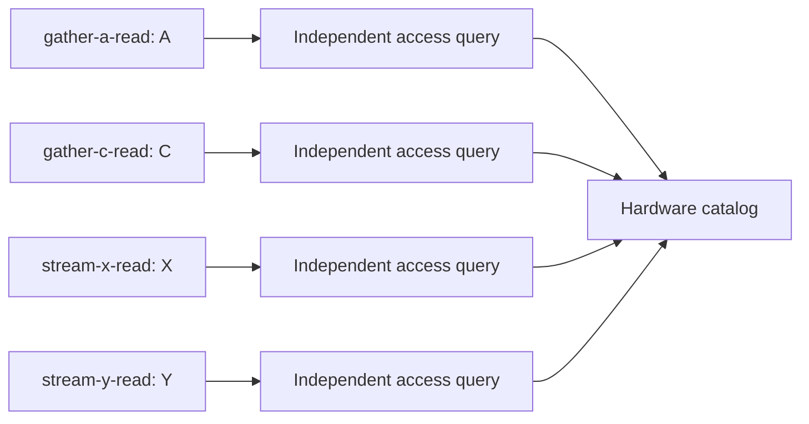
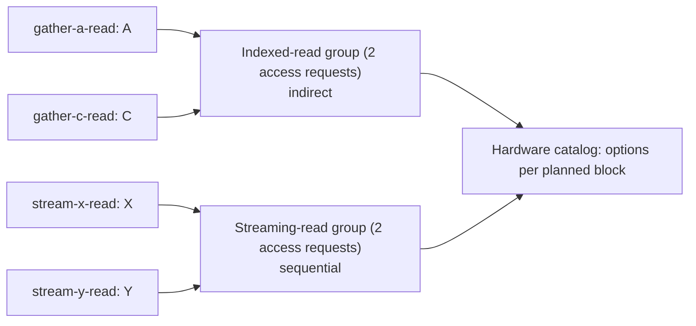

# Hardware planning before catalog lookup

Requests for capability groups, not a physical partition, proved composition or cost-optimal clustering.

| Proposed block | Source requests | Required shapes | Catalog option status |
|---|---|---|---|
| block-indexed-read-d9d3cdfc04 | gather-a-read, gather-c-read | indirect | options_for_review |
| block-stream-read-3e4c92e98e | stream-x-read, stream-y-read | sequential | options_for_review |

## Before: independent requests

## After: capability planning

Grouping suggests shared capabilities, not simultaneous execution, a physical partition or permission to reorder.
Source dependencies, mutable reads, unresolved resources and CPU effects remain in the YAML.
A catalog option must cover every typed clause using one design record and one execution role.
Partial matches are retained as diagnostics, not silently combined into a new accelerator.

[Plan](hardware-plan.yaml) · [Catalog results](block-catalog-results.yaml)
