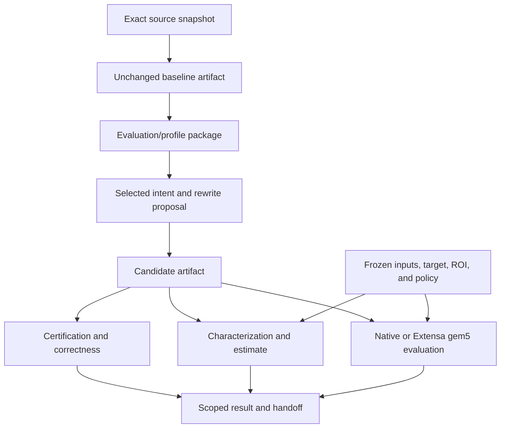

# 4. Follow BFS through rewrites and evidence

Updated: 2026-10-14 (Eastern Time). Reading budget: 9 minutes.

[Tutorial](README.md) · [Previous](03-components.md) · [Next](05-contributing.md)

Breadth-first search (BFS) finds reachable vertices and their distance from a
starting vertex. Its parent array describes the traversal tree. SWDB keeps source,
graph, traversal sources, correctness scope, and speed evidence bound together.

## Choose the mode before collecting evidence

| Mode | Speed evidence | Correctness and selection |
|---|---|---|
| ArchEvolve, the default | Analytic estimates; native CPU timing remains available for validation | One proposal with bounded build/correctness repair. Functional-target checks where hardware cannot execute; no gem5 execution/calibration dependencies |
| Extensa research | Native timing or gem5; paired estimates assess agreement | Budgeted rewrite/certify/evaluate iterations. Rank certification first, then qualified performance, separately per workload class |

[Team policy](../../swdb/archevolve.py) checks dependency records before new
operations. Research commands use `--mode extensa --campaign ID`; campaign execution
sets these tags itself. Historical simulator records remain retrievable, with
their original evidence meaning.

## Bind source, workload, and policy

Upstream direction-optimizing `gapbs-bfs-do` and DX100 scalar top-down
`dx100-bfs-scalar` share kernel `gapbs-bfs`, with different source, build, and
evaluator contexts. Format `0.4` names these; older records use kernel defaults.

`source_ancestor` describes ancestry. `source_baseline` names the application's
baseline. `comparison_baseline` selects the comparator, which may be another
implementation of the same kernel. Rewriting one source does not select that
comparison automatically.



Mode selects the assessment branches. **Region of interest (ROI)** names the
computation boundary whose work or time is assessed.

1. **Retain source.** `source-snapshot` pins source, regions, context, and protections.
   `baseline-candidate` copies it unchanged.
2. **Identify input.** `register-workload` verifies graph equivalence and retains
   ordered traversal sources.
3. **Freeze policy.** `freeze-protocol` seals identities and settings. Estimates
   also pin target parameters, input arguments, dependencies, and estimator code.
4. **Assemble context.** `profile-package` joins matching observations and records
   missing parts explicitly.
5. **Rewrite and check.** Submit intent and source/package identity with permitted
   files and required operations. Retain source or rejection; certify and check correctness.
6. **Assess.** Compare compatible evidence against an explicit baseline. Read
   scope, unknowns, and verdict before claiming gain.

## A contract gives a rewrite testable obligations

The typed library contains intrinsics, **lowerings** (code implementing an
intrinsic over a hardware interface), library operations, and rewrite contracts.
A contract matches access patterns by role and states applicability, legality,
preservation obligations, and tunable knobs.

Entries and code pins live in `library/`. Certification/review records derive
their state. Certification tests exact content and negative controls, without
establishing proof or performance. Formal clauses remain `stated`. The Extensa
Probata formal-verification workflow and its proof records are
[proposed](../adr/0016-proof-records-never-change-level-computed-on-read.md), with no formal verifier implemented.

ArchEvolve proposals that cite a library contract must pin its dependencies and
use current shared certified entries. Experimental entries belong to Extensa.
Candidate level is derived from current receipts. Inspect a contract without execution:

```sh
# Run inside ArchEvolve/swdb-project/.
python3 -B -m swdb get contract.bfs_read_offload --format json
```

## The provider edits; the evaluator judges

The operator selects `--provider-config` independently of proposal text.
Real providers are pinned in [adapters](../../swdb/provider_adapters.py): Codex
`gpt-5.6-sol`/`xhigh` or Claude `claude-sonnet-5-5`/`high`; overrides are refused.
Real roles run on mbit10 in an owned socket lane, with evaluator inputs, workload
data, other candidate artifacts, and authors' accelerated code hidden.

The workspace confines and audits the process tree, checks source edits, refreshes
login state under a lock, and cleans build/login copies. Guard limits include
unrestricted UDP and a readable session login copy; see the
[worker contract](../reference/bfs-rewrite-worker.md). Deterministic providers are fixtures.

Repair handles eligible build/correctness failures and unavailable providers,
preserving intent and provider settings. A usage-limit failure consumes elapsed
time without a repair attempt. A valid regression triggers no ArchEvolve tuning.
Extensa's performance loop is a separate interface.

## Estimates retain unknowns

`characterize` compiles one C/C++ translation unit with LLVM 22 and runs an
instrumented binary to count work. Registered adapters verify source/input/trial
binding; arbitrary source hashes alone leave application binding unverified.
Counts are observations of work, not hardware-target time.

`estimate` combines the characterization with a **target description**, whose
mechanism models and parameters describe hardware behavior. It retains
`basis: estimated`, known component bounds, and missing facts. Unknown required
costs, unsupported access mechanisms, or unspecified resource overlap leave the
total `null`. For trial characterizations, it estimates each whole call and takes
the median; diagnostic region medians need not sum to that result.

`fill-target-parameters` fills supported numerical unknowns, retaining estimated
basis. Missing coverage, mechanisms, and overlap premises stay unknown. Estimates
need a matching frozen protocol; estimator changes require a fresh freeze. A ratio
needs applicable error qualification before establishing gain.

For source-only DX100 targets, `evaluate-functional` joins current strict-functional
execution certification with a frozen estimate. It retains
`correctness_scope: functional-target`, no performance timing, and
`hardware_correctness_claim: false`. Its handoff uses version 1.1.

ArchEvolve packages offer `dx100_read_offload.functional-v1`, whose dependencies
describe functional source. The memory-mapped I/O (MMIO) strategy
`dx100_read_offload` depends on gem5 and belongs to Extensa. The
[package builder](../../swdb/profile_package.py) filters
strategies/intrinsics through team policy; changing a name cannot bridge the families.

To explain two saved estimates, `attribute` diffs their retained source trees and
groups estimated time as untouched, rewritten, or unattributed. Inputs, target description,
threads, evidence kind, and estimator hash must match. Optional region profiles
check estimated versus measured shares. Only a passing split check lets attribution
reorder regions already chosen for an Extensa campaign. Bounds remain limits,
not predicted gains. See [attribution](../reference/format-v0.4-attribution.md) for arguments.

## Timed research evidence has its own gates

Native evaluation retains timings, independent parent-array checks,
build/source/input identities, trials, and environment. Paired collection orders
A/A repeatability or A/B comparisons prospectively. Native `bfs.complete_call.v1`
and the DX100 author's internal ROI differ.

Extensa gem5 needs compatible model/binary/checkpoint/input identities plus
accelerator/completion witnesses. Simulator exit alone cannot establish correctness;
full-tile, tail-tile, and competing-parent cases need separate coverage.

`campaign` applies declared iteration, lane-hour, provider-call, and disk budgets.
Native campaigns gate each workload class on an A/A pilot under their frozen
speed rule. Failed classes remain `baseline_unstable`; rules are not loosened
mid-run. Non-promoted evidence stays in the campaign store; the summary also
enters the repository record store. Export retains tags. Promotion requires a
recorded review and fresh evaluation under a derived team protocol; team policy
still applies to its dependencies.

[Campaign pairing](../../swdb/extensa_pairing.py), when enabled, retains unknown
source-metadata receipts after protocol freeze and before candidate certification,
including repairs.
Seconds stay `null`; receipts cannot authorize timing or enter agreement. Timed
requests have separate forecasts. No verified complete-call adapter exists.

**Real campaigns are currently start-blocked (D35):** a new real-target campaign
needs `paired_estimates.numeric_pairing_check`, naming a real numeric estimate
recorded before timing and admitted by the strict audit. The schema currently
requires unknown estimates, so none can pass. Fixtures and resumes are exempt.
See the
[format reference](../reference/format-v0.4-extensa.md#start-gate-d35-2026-10-09).

[Certification](../../swdb/campaign_targets.py) sends candidate scope, harness-scan,
and mutation-site refusals to bounded repair. Compiler, trusted-build,
configuration, and trusted-file errors stop with `infrastructure_failure`,
preserving the interrupted iteration without repair or plateau progress.

## Read a historical handoff without reinterpreting it

```sh
python3 -B -m swdb get \
  bfs-campaign-preparation-20260925-a1.dx100-patch --chain --format json
```

The [proposal example](../bfs-handoff-examples/rewrite-proposal.sw-patch.json)
requests dynamic scheduling and removal of a redundant store. Its completed
[evaluation example](../bfs-handoff-examples/evaluation-result.dx100-patch-kronecker.json)
is inconclusive. Later T17 [Kronecker](../../records/comparison_results/bfs-t17-handoff-20260929-a1.kronecker18.yaml)
and [uniform](../../records/comparison_results/bfs-t17-handoff-20260929-a1.uniform18.yaml)
records retain `gain` with attribution `joint_hardware_software`: both source
and accelerator presence changed. These historical decisions do not establish
hardware-only gain or authorize a new ArchEvolve gem5 handoff.

Package completeness, correctness, accelerator coverage, raw-file availability,
and profitability remain separate. Locally unavailable remote artifacts remain
`remote_unverified`; this reading path does not reverify them.

**[Next: contribute records and choose a profiling procedure →](05-contributing.md)**
